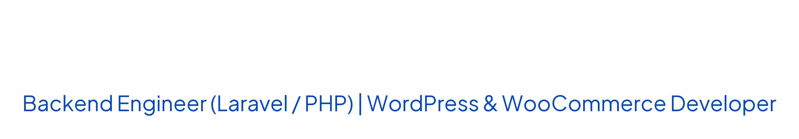

  

  
  
  
  

### **@youssefhossam29 - Backend Engineer (Laravel / PHP) & WordPress Developer**

Specializing in building scalable Laravel web applications, robust RESTful APIs, database architectures, and custom WordPress solutions.

Hands-on experience building financial & wallet systems, real-time features (chat and notifications), and integrations with Paymob, MinIO/AWS S3, and Google/Microsoft OAuth.

Experienced in developing responsive, multilingual corporate websites with dynamic content (Custom Post Types & Loops), alongside custom WordPress plugins, WooCommerce stores, and LMS & booking solutions.

Computer Science graduate from Alexandria University (GPA: 3.6/4) and ITI alumnus (CMS Track).

**Tech Stack:** PHP, Laravel, RESTful APIs, MySQL, HTML, CSS, JavaScript, WordPress, Elementor, WooCommerce, Custom Plugin Development, JetEngine, ACF.

